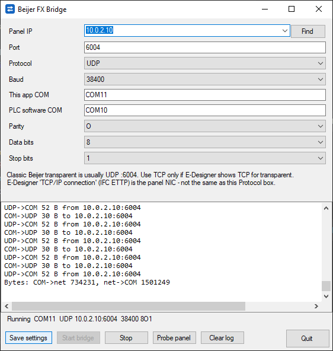

# BeijerFXBridge

BeijerFXBridge (`BeijerFXBridgeNet.exe`) is a small Windows app (.NET Framework 4.8,
WinForms) that bridges a com0com virtual COM port to a Beijer HMI panel's transparent mode over UDP or TCP, so Mitsubishi
PLC software (GX Developer, GX Works2, GX IEC Developer...) can talk to the PLC
through the panel.

    PLC software --COM10== com0com ==COM11-- BeijerFXBridgeNet --UDP/TCP--> panel :6004 --> PLC

## com0com setup

1. Install com0com and create a port pair, e.g. `COM10 <-> COM11`
   (setupc: `install PortName=COM10 PortName=COM11`).
2. "This app COM" = COM11 (opened by the bridge).
3. "PLC software COM" = COM10: select this port in GX Developer / GX Works2 /
   GX IEC Developer. The bridge does not open it; the field is for reference.
4. Only one program can own COM11 - stop any other bridge first.

## Config

`config.ini` next to the exe:

    [bridge]
    com = COM11
    plc_com = COM10
    host = 10.0.0.10
    port = 6004
    protocol = udp
    baud = 115200
    parity = E
    bytesize = 7
    stopbits = 1
    bind = 0.0.0.0
    local_port = 0
    verbose = true

`gx_com` is also accepted instead of `plc_com`. `protocol` is
`udp` or `tcp`, `parity` is E/N/O, `local_port = 0` means a random UDP source
port, `verbose = true` logs every packet. Inline comments are not supported.

UDP ignores packets that are not from the panel IP. TCP uses NoDelay and
reconnects every 2 s if the link drops.

## Run

- GUI: `BeijerFXBridgeNet.exe` (Save settings / Start bridge / Stop / Clear log / Quit)
- CLI: `BeijerFXBridgeNet.exe --cli [--com COM11] [--host 10.0.0.10] [--port 6004] [--protocol udp|tcp]`
  (also `--baud --parity --bytesize --stopbits --bind --local-port -v`, `--help`). Ctrl+C stops.

## Probe panel

The **Probe panel** button opens a read-only network scan to find the panel:

- If a Panel IP is set it is checked first (ping, TCP connect and UDP check on the configured port).
- **Scan** checks the local subnet of each ticked network adapter (max 1024 addresses per range).
  Tailscale/ZeroTier/VPN adapters are unticked by default; tick one to scan its subnet and, for
  Tailscale, the subnet routes via that adapter plus peers from `tailscale status --json` (longer timeouts).
- Only likely panels are listed (Beijer MAC, TCP port open, or UDP open|filtered with no web server)
  plus the configured host; tick *Show all hosts* to list every responder.
- *Extra range* accepts e.g. `192.168.3.0/24` or `10.0.2.1-50`.
- Results show ping time, TCP and UDP result for the port, HTTP title/Server on port 80, MAC from the
  ARP table and *Likely panel* (Beijer Electronics MAC OUI). MAC detection only works on the local L2 network.
- Double-click a row or press **Use** to set Panel IP (and the protocol that answered).

The probe only sends ping, TCP connects, one empty UDP datagram and an HTTP GET; no PLC data, no COM ports.

## Build (Linux or Windows, .NET SDK)

Targets .NET Framework 4.8, which is built into Windows 10/11, so the exe runs
with nothing installed. The reference-assemblies package lets it build on Linux.

    dotnet build -c Release

Output: `bin/Release/net48/BeijerFXBridgeNet.exe` (ship it with `config.ini`;
the `.exe.config` file is optional).

## Installer

`installer/` holds an Inno Setup 6 script. It installs the exe and a default
config.ini into Program Files\BeijerFXBridge (users get modify rights there,
so Save settings works), and adds Start menu, optional desktop shortcut and an
uninstaller. If com0com is missing, it runs the bundled signed com0com 2.2.2.0 x64
setup silently. If COM10 and COM11 are both free, it creates that pair with
`setupc install PortName=COM10 PortName=COM11`. An existing com0com setup is
never changed, and uninstalling leaves com0com alone.

Build on Linux (Wine with the null display driver works headless):

    export WINEPREFIX=~/.wine-inno
    wine reg add 'HKCU\Software\Wine\Drivers' /v Graphics /d null /f
    wine innosetup-6.7.3.exe /VERYSILENT /SUPPRESSMSGBOXES /SP- '/DIR=C:\InnoSetup6'
    installer/build.sh     # -> installer/Output/BeijerFXBridge-1.1.0-setup.exe

## License

MIT, see [LICENSE](LICENSE). The installer also installs it as `LICENSE.txt`.
The bundled com0com is GPL (`installer/com0com/COPYING.txt`).

## Short UDP replies (1.2.3)

In UDP mode the panel sometimes answers a request with only part of the reply, and the PLC software then
stalls until its own retry. With `fix_short_replies = true` (default) the bridge buffers the reply until it
reaches `expected_reply` bytes (default 70; 0 = learn the most common length). If it stays short for
`reply_wait_ms` (default 100), the partial is dropped and the last request is resent, up to `max_resends`
(default 2); after that whatever arrived is forwarded so the PLC software can retry. Longer replies are passed
through unchanged. TCP mode is not affected. Missing keys in an existing config.ini use these defaults.
